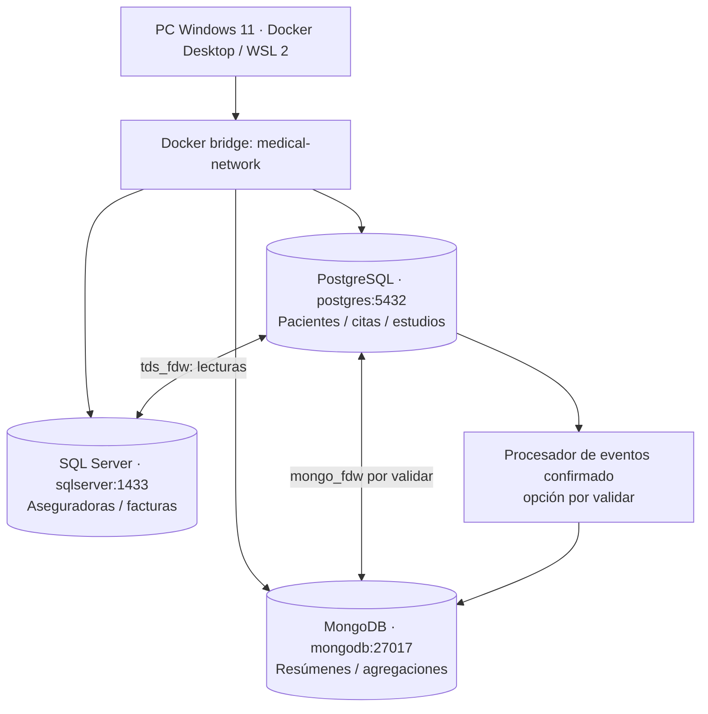

# Arquitectura de infraestructura y datos

## Plataforma elegida [GRUPO]

- Host físico único: **Windows 11, Ryzen 5 5600G (x86-64), 16 GB RAM, GPU RTX 5060**.
- Entorno: **Docker Desktop + WSL 2**; tres contenedores Linux aislados como servicios lógicos. No se pretende distribución física ni alta disponibilidad.
- Persistencia: un volumen nombrado por motor, más respaldos exportables; red privada `medical-network`.
- Sistema de nombres Docker por servicio; `localhost` dentro de un contenedor NO identifica los otros contenedores.
- Sin frontend ni API: usar clientes DB/consultas para demostrar los roles preparados para aplicaciones futuras.

## Diagrama lógico [PROPUESTA]

**Leyenda:** flechas indican flujo lógico, no que la comunicación ya haya sido implementada ni que haya garantías de transacción ACID distribuida.

## Servicios previstos [PROPUESTA]

| Servicio Compose | Motor / versión preseleccionada | Puerto interno | Volumen |
|---|---|---:|---|
| `postgres` | PostgreSQL 16, imagen personalizada con extensiones | 5432 | `postgres_data` |
| `sqlserver` | SQL Server 2022 Developer (Linux) | 1433 | `sqlserver_data` |
| `mongodb` | MongoDB 8.0 (validar soporte con FDW) | 27017 | `mongodb_data` |

- Nombre de red `medical-network`.
- Si se publican puertos hacia Windows para clientes, **vincular solo a 127.0.0.1**, no a todas las interfaces; preferir red interna entre servicios.
- `healthcheck` por motor, no confundir «running» con «ready».
- Preparar `.env.example`, `.env` local ignorado y secretos **fuera del control de versiones**.
- Revisar recursos WSL y límites SQL Server; 16 GB es una estimación adecuada para dataset pequeño, no prueba de rendimiento.
- Reservar preferiblemente 30–40 GB libres en SSD; revisar virtualización AMD-V y WSL 2 antes de instalar.
- La RTX 5060 no se necesita para los motores.

## Presupuesto tentativo, NO medición

- Windows + aplicaciones de escritorio: ~8 GB.
- SQL Server: ~3 GB; PostgreSQL: ~1 GB; MongoDB: ~1.5 GB; resto ~2.5 GB para WSL/Docker/margen.
- Es solo guía de dimensionamiento inicial; Docker/WSL incluyen overhead y no deben configurarse límites que impidan el arranque. Ajustar tras observar consumos reales.

## Direccionalidad

1. PostgreSQL es dueño del núcleo clínico y del control de exportaciones.
2. SQL Server es dueño de aseguradoras, convenios y facturación simulada; PostgreSQL **consulta** sus objetos por FDW.
3. MongoDB consume datos clínicos resumidos **tras confirmación en PostgreSQL** y devuelve resultados analíticos a consultas.
4. Los datos no se sincronizan mágicamente por compartir una red. Los flujos de escritura requerirán procedimientos explícitos.

## Aprobaciones y riesgos

- **Pendiente**: confirmar con el docente que tres servidores lógicos en una PC bastan para el requisito «distribuido».
- **Pendiente**: compilación real de `tds_fdw` y `mongo_fdw` con imágenes y dependencias elegidas.
- **Pendiente**: confirmar puertos libres, SSD suficiente, WSL 2 y recursos.

## Preparación de infraestructura — 22/10/2026, Joseph

`compose.yaml` implementa la topología prevista y `compose.local.yaml` ofrece publicación opcional
solo localhost. La red `medical-network` usa `internal: true`; no hay puertos host por defecto.
Se agregó volumen `mongodb_config` para /data/configdb, sin modificar el modelo MongoDB.
Límites: PostgreSQL 1 GiB, SQL Server 3 GiB (límite interno 2048 MB), MongoDB 1.5 GiB (caché 0.5 GB).
No hay medición de rendimiento ni prueba local de arranque. Versiones siguen como candidatos de spike;
ver `documentacion/COMPATIBILIDAD_FDW.md` y D-027.

## Puertos locales efectivos — 22/10/2026, Joseph (D-034)

Una ejecución Windows mostró que el primer overlay guardaba los bindings solicitados en
`HostConfig.PortBindings`, pero `NetworkSettings.Ports` quedó vacío y el host no escuchaba:
Docker no publicó puertos de contenedores conectados **solo** a `medical-network` interna.
El overlay corregido agrega una pasarela TCP `port-gateway` (HAProxy 3.2.26) sin credenciales
ni datos persistentes. Es el único servicio conectado a `host-access` (bridge no interno)
y a `medical-network`; publica 5432, 1433 y 27017 solamente en 127.0.0.1 (puertos host
configurables). Los tres motores conservan solo `medical-network`, `internal: true`.
Es un cuarto contenedor auxiliar, **no** un cuarto motor ni un cambio de autoridad de datos.
En modo base no se crea la pasarela ni se publican puertos. El acceso desde Windows es
opcional y no reemplaza las conexiones motor a motor dentro de la red interna.
