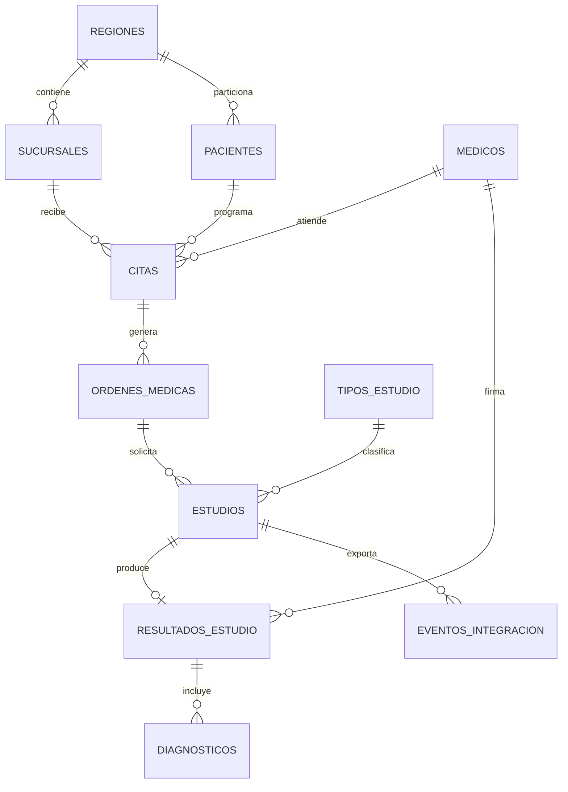

# Modelo de datos V1 — especificación previa a implementación

**Estado [PROPUESTA]:** modelo lógico consensuado en planificación; no implica DDL ejecutado. Los tipos, tamaños y estados son orientativos y deberán ser coherentes entre motores. No cambiar claves compartidas unilateralmente.

## PostgreSQL — transaccional

| Tabla | Columnas principales y reglas acordadas | Relaciones |
|---|---|---|
| `regiones` | `codigo_region CHAR(2) PK`; `nombre VARCHAR(60) UNIQUE NOT NULL` | SJ, AL, CA |
| `sucursales` | `id_sucursal INTEGER PK`; `codigo_region CHAR(2) NOT NULL FK`; `nombre VARCHAR(100) NOT NULL`; `direccion VARCHAR(200)`; `activa BOOLEAN NOT NULL` | regiones 1:N sucursales |
| `pacientes` | `id_paciente BIGINT`; `codigo_region CHAR(2) FK`; `nombre VARCHAR(80)`; `apellidos VARCHAR(120)`; `fecha_nacimiento DATE`; `telefono VARCHAR(20)`; `correo VARCHAR(120)`; `fecha_registro TIMESTAMPTZ` | `PK(id_paciente,codigo_region)`; region determina partición |
| `medicos` | `id_medico BIGINT PK`; `nombre VARCHAR(80)`; `apellidos VARCHAR(120)`; `especialidad VARCHAR(100)`; `activo BOOLEAN` | médico 1:N citas/resultados |
| `usuarios_administrativos` | `id_usuario BIGINT PK`; `nombre VARCHAR(120)`; `correo VARCHAR(120) UNIQUE`; `activo BOOLEAN` | personal, NO sustituye roles SQL |
| `citas` | `id_cita BIGINT PK`; `id_paciente BIGINT`; `codigo_region CHAR(2)`; `id_medico BIGINT`; `id_sucursal INTEGER`; `fecha_hora TIMESTAMPTZ`; `estado VARCHAR(20)` | FK compuesta a pacientes; FK a médicos y sucursal |
| `ordenes_medicas` | `id_orden BIGINT PK`; `id_cita BIGINT FK`; `fecha_emision TIMESTAMPTZ`; `indicaciones TEXT`; `estado VARCHAR(20)` | citas 1:N órdenes |
| `tipos_estudio` | `id_tipo INTEGER PK`; `nombre VARCHAR(100) UNIQUE`; `categoria VARCHAR(60)`; `descripcion TEXT` | tipos 1:N estudios |
| `estudios` | `id_estudio BIGINT PK`; `id_orden BIGINT FK`; `id_tipo INTEGER FK`; `estado VARCHAR(20)`; `fecha_realizacion TIMESTAMPTZ` | orden 1:N estudios |
| `resultados_estudio` | `id_resultado BIGINT PK`; `id_estudio BIGINT FK UNIQUE`; `id_medico_firmante BIGINT FK`; `resumen TEXT`; `fecha_resultado TIMESTAMPTZ`; `revision INTEGER > 0` | estudio 0:1 resultado |
| `diagnosticos` | `id_diagnostico BIGINT PK`; `id_resultado BIGINT FK`; `descripcion TEXT`; `codigo_diagnostico VARCHAR(30)` | resultado 1:N diagnósticos |
| `eventos_integracion` | `id_evento UUID PK`; `id_estudio BIGINT`; `revision INTEGER`; `tipo_evento VARCHAR(40)`; `estado VARCHAR(20)`; `intentos INTEGER`; `fecha_creacion`, `fecha_procesamiento TIMESTAMPTZ` | outbox local (mejora propuesta) |

**NOT NULL implícitos de diseño:** claves foráneas obligatorias, nombre/apellido/fecha paciente, médico, tipo y estados, resúmenes y fecha firmada; validar explícitamente al crear DDL.

### Estados previstos

- `citas.estado`: `PROGRAMADA`, `COMPLETADA`, `CANCELADA`.
- `estudios.estado`: `SOLICITADO`, `EN_PROCESO`, `FINALIZADO`, `CANCELADO`.
- `eventos_integracion.estado`: `PENDIENTE`, `PROCESADO`, `ERROR`; definir política de reintentos antes de codificar.
- `revision` comienza en 1, aumenta cuando se modifica el resultado.

### Relaciones

La relación conceptual debe transformarse en FKs, índices y restricciones ejecutables. Ejemplo: prevenir citas simultáneas conflictivas solo para estados activos; definir consulta exacta más adelante.

### Partición horizontal

`pacientes PARTITION BY LIST (codigo_region)` con `pacientes_sj` ('SJ'), `pacientes_al` ('AL') y `pacientes_ca` ('CA'). **No son tres nodos PostgreSQL.** Consultas `EXPLAIN` permitirán demostrar pruning. Con PG particionado, PK/UNIQUE en tabla padre deben incluir clave de partición; se propone PK compuesta `(id_paciente,codigo_region)`, y FKs de citas a ambos campos. Un identificador global creado por secuencia es convención de generación, **no** garantía formal de unicidad global si se insertan datos por fuera del mecanismo.

Distinguir `codigo_region` del paciente de la región de **atención**, derivada de la sucursal: un paciente puede atenderse en otra provincia.

## SQL Server — integración externa (simulada)

| Objeto | Columnas y reglas propuestas |
|---|---|
| `aseguradoras` | `id_aseguradora PK`, `nombre`, `codigo_externo`, `activa` |
| `convenios` | `id_convenio PK`, `id_aseguradora FK`, `codigo_institucion`, `fecha_inicio`, `fecha_fin`, `estado` |
| `paciente_integracion` (**fragmento vertical 1**) | `id_paciente BIGINT`, `codigo_region CHAR(2)`, `id_aseguradora`, `codigo_externo`; **PK compuesta** `(id_paciente,codigo_region)` |
| `paciente_cobertura` (**fragmento vertical 2**) | `id_paciente BIGINT`, `codigo_region CHAR(2)`, `estado_cobertura`, `estado_facturacion`, `fecha_validacion`; **PK compuesta** y FK al fragmento 1 |
| `facturas_externas` | `id_factura PK`, `id_estudio BIGINT`, `id_paciente BIGINT`, `codigo_region CHAR(2)`, `monto DECIMAL(12,2) CHECK(monto>=0)`, `fecha`, `estado` |
| `resumen_facturacion` | `id_paciente`, `codigo_region`, `cantidad_facturas`, `total_facturado_crc`, `fecha_actualizacion` (materializada por procedimiento, si se decide conservar) |

La **segmentación vertical** divide columnas de una misma entidad `paciente_asegurado` y permite reconstruirla por `JOIN` en su clave compuesta. Dos tablas sin esa equivalencia no bastan para demostrar segmentación vertical. La facturación y convenios externos no tienen FK física hacia PostgreSQL.

**Vista remota**: `dbo.vw_estado_facturacion` una fila por `(id_paciente,codigo_region)`, con `nombre_aseguradora`, `estado_cobertura`, `estado_facturacion`, `total_facturado_crc`, `fecha_actualizacion`. Debe reconstruir fragmentos y, en SQL Server, preagregar facturas para evitar multiplicación de filas.

## MongoDB — documental analítico

Colecciones:

1. `resumenes_estudios`: documento por estudio terminado, índice **UNIQUE sobre `id_estudio`**, más `_id` del motor.
2. `indicadores_mensuales`: agregaciones persistidas **opcionales**, posteriores a demostrar agregaciones directamente sobre `resumenes_estudios`.

Campos previstos del resumen: `id_estudio` Int64, `id_paciente` Int64, `codigo_region` String (registro), `id_medico` Int64 (médico firmante), `id_tipo` Int32, `tipo_estudio` String, `id_sucursal` Int32, `codigo_region_atencion` String, `fecha_resultado` BSON Date (UTC), `resultado_resumen` String, `revision` Int32, `fecha_sincronizacion` BSON Date (UTC). No incluir nombres completos ni contacto del paciente salvo justificación.

**Pendientes a validar**: cómo `mongo_fdw` mapea `ObjectId`, BSON Int64, actualizaciones, filtro por índice y conversiones de fecha. La documentación externa no sustituye una prueba real.

## Datos de demostración [PROPUESTA]

3 regiones y 3 sucursales, 30 pacientes (10 por región), 6 médicos, 30 citas, 25 órdenes, 40 estudios, 30 resultados, 3 aseguradoras; facturas con estados diferentes. Son **cantidades propuestas**, nunca requisitos del curso. Usar personas y datos completamente ficticios. Las filas que prueben sincronización deben originarse mediante la integración real, NO mediante inserción manual simulando éxito.
