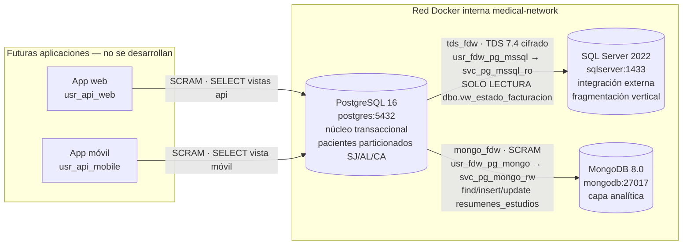

# Mapa de conexiones y configuración FDW

Entregable 3 del enunciado: canales de conexión, `postgresql.conf`, `pg_hba.conf`, `CREATE SERVER`,
mapeos, roles internos/externos y consultas de prueba. Los valores de este documento salen de
la ejecución real registrada en `evidencias/registros/2026-10-25-joyce-entrega-p12-p17-p18.txt`.

## 1. Despliegue

Una PC con Windows 11, Docker Desktop y WSL 2. Corren tres contenedores (tres servidores
lógicos) conectados a la red Docker `medical-network`, definida como `internal: true`. Los
motores no publican puertos hacia la PC. El overlay opcional `compose.local.yaml` agrega un
gateway que publica únicamente en `127.0.0.1`.



| Canal | Origen → destino | Mecanismo | Perfil PostgreSQL | Cuenta remota | Permisos remotos |
|---|---|---|---|---|---|
| Facturación (INT-01, INT-03) | PostgreSQL → SQL Server | `tds_fdw` 2.0.5 (+ parche D-040), FreeTDS TDS 7.4, `encryption=require` | `usr_fdw_pg_mssql` | `svc_pg_mssql_ro` (SQL login, política de contraseñas activa) | `SELECT` solo sobre `dbo.vw_estado_facturacion`; `DENY` explícito en tablas y `EXECUTE` |
| Resúmenes (INT-02, INT-04) | PostgreSQL → MongoDB | `mongo_fdw` 5.5.3 (extensión 1.1), driver C 1.30.2 | `usr_fdw_pg_mongo` | `svc_pg_mongo_rw` (SCRAM-SHA-256) | rol `rol_exportacion_resumenes`: find/insert/update en `reportes_medicos.resumenes_estudios` |
| API web | App → PostgreSQL | libpq, SCRAM-SHA-256 | `usr_api_web` | — | `SELECT` en `api.vw_paciente_facturacion` y `api.vw_citas_web` |
| API móvil | App → PostgreSQL | libpq, SCRAM-SHA-256 | `usr_api_mobile` | — | `SELECT` en `api.vw_citas_mobile` |

## 2. `postgresql.conf` (`docker/postgres/postgresql.conf`)

| Parámetro | Valor | Motivo |
|---|---|---|
| `listen_addresses` | `*` | Escucha dentro de la red interna; `pg_hba.conf` filtra |
| `port` | 5432 | — |
| `password_encryption` | `scram-sha-256` | Contraseñas de los perfiles con SCRAM |
| `hba_file` | `/etc/postgresql/pg_hba.conf` | Reglas versionadas |
| `log_statement` | `none` | Los `USER MAPPING` contienen credenciales: no se registran sentencias |
| `timezone` | `UTC` | Fechas normalizadas entre motores |
| `ssl` | `off` | Limitación de laboratorio (red interna) |

## 3. `pg_hba.conf` (`docker/postgres/pg_hba.conf`), reglas efectivas

| Tipo | Usuario | Dirección | Método |
|---|---|---|---|
| local | postgres | socket | peer (administración en el contenedor) |
| local | todos | socket | scram-sha-256 |
| host | todos | 127.0.0.1 / ::1 | scram-sha-256 |
| host | todos | `samenet` (red Docker interna) | scram-sha-256 |
| host | todos | 0.0.0.0/0, ::/0 | **reject** |

Además, `REVOKE CONNECT ON DATABASE ... FROM PUBLIC`: solo los cuatro perfiles del curso
(y el administrador) pueden conectarse a `estudios_medicos`.

## 4. Objetos FDW (salida real de los catálogos)

```sql
-- integracion/01_fdw_sqlserver.sql (Joseph)
CREATE SERVER sqlserver_medico FOREIGN DATA WRAPPER tds_fdw
  OPTIONS (servername 'sqlserver', database 'integracion_externa',
           tds_version '7.4', sqlserver_ansi_mode 'true');
CREATE USER MAPPING FOR usr_fdw_pg_mssql SERVER sqlserver_medico
  OPTIONS (username 'svc_pg_mssql_ro', password '<secreto>');
CREATE FOREIGN TABLE externo.ft_estado_facturacion (...) SERVER sqlserver_medico
  OPTIONS (query 'SELECT ... FROM dbo.vw_estado_facturacion', ...);

-- integracion/02_fdw_mongodb.sql (Joyce)
CREATE SERVER mongo_reportes FOREIGN DATA WRAPPER mongo_fdw
  OPTIONS (address 'mongodb', port '27017', authentication_database 'reportes_medicos');
CREATE USER MAPPING FOR usr_fdw_pg_mongo SERVER mongo_reportes
  OPTIONS (username 'svc_pg_mongo_rw', password '<secreto>');
CREATE FOREIGN TABLE externo.ft_resumenes_estudios (_id name, id_estudio bigint, ...)
  SERVER mongo_reportes OPTIONS (database 'reportes_medicos', collection 'resumenes_estudios');
```

| Servidor | Wrapper | Mapping (sin contraseña) | Tabla foránea |
|---|---|---|---|
| `sqlserver_medico` | `tds_fdw` 2.0.5 | `usr_fdw_pg_mssql` → `username=svc_pg_mssql_ro` | `externo.ft_estado_facturacion` |
| `mongo_reportes` | `mongo_fdw` 1.1 | `usr_fdw_pg_mongo` → `username=svc_pg_mongo_rw` | `externo.ft_resumenes_estudios` |

Ningún otro rol tiene `USER MAPPING`: el administrador y los perfiles externos no pueden usar
los servidores remotos directamente.

## 5. Perfiles internos y externos

| Perfil | Tipo | Login | Políticas | Puede | No puede |
|---|---|---|---|---|---|
| `usr_fdw_pg_mssql` | interno | SCRAM | — | Leer `externo.ft_estado_facturacion` y `clinico.pacientes`; es dueño de `externo.fn_estado_facturacion()` | Escribir en SQL Server (FDW de solo lectura y cuenta remota de solo `SELECT`) |
| `usr_fdw_pg_mongo` | interno | SCRAM | 3 conexiones | Ejecutar `integracion.exportar_pendientes()`; leer/insertar/actualizar resúmenes; leer las tablas clínicas necesarias para armar el resumen; marcar eventos | Leer `clinico.pacientes`, borrar en MongoDB, modificar resultados |
| `usr_api_web` | externo | SCRAM | 20 conexiones, solo lectura, timeout 15 s | `api.vw_paciente_facturacion`, `api.vw_citas_web` | Tablas base, tabla foránea, vista móvil, escrituras |
| `usr_api_mobile` | externo | SCRAM | 50 conexiones, solo lectura, timeout 5 s | `api.vw_citas_mobile` | Facturación, agenda web, tablas, función remota, escrituras |
| `api_propietario` | dueño de vistas | NOLOGIN | — | Concentra los `SELECT` sobre tablas base que usan las vistas | Iniciar sesión |

`tds_fdw` usa el mapping **del usuario que consulta**. Por eso la vista web lee SQL Server a
través de `externo.fn_estado_facturacion()` (`SECURITY DEFINER`, dueño `usr_fdw_pg_mssql`):
todo acceso remoto sale por el perfil interno (D-042).

## 6. Segmentación

| Motor | Tipo | Implementación | Prueba |
|---|---|---|---|
| PostgreSQL | Horizontal | `clinico.pacientes PARTITION BY LIST (codigo_region)`: `pacientes_sj`, `pacientes_al`, `pacientes_ca` (sin DEFAULT); PK `(id_paciente, codigo_region)` | P14 (Joseph), `EXPLAIN` con pruning |
| SQL Server | Vertical | Entidad *paciente asegurado* = `paciente_integracion` (aseguradora, código externo) + `paciente_cobertura` (cobertura, facturación), unidas 1:1 por la clave compuesta; reconstrucción en `dbo.vw_paciente_asegurado` | P15 |
| MongoDB | Documental | Un documento desnormalizado por estudio (`resumenes_estudios`) + `indicadores_mensuales` | P09 |

## 7. Consultas de prueba entre motores

| Operación del enunciado | Consulta | Evidencia |
|---|---|---|
| Paciente + facturación SQL Server | `SELECT ... FROM clinico.pacientes p LEFT JOIN externo.ft_estado_facturacion f USING (id_paciente, codigo_region)` (login `usr_fdw_pg_mssql`) | P01 |
| Inserción que tras confirmarse actualiza MongoDB | `SELECT * FROM integracion.registrar_resultado(...)`; COMMIT; `CALL integracion.exportar_pendientes()` | P04–P08, P13 |
| Vista local + remota para la web | `SELECT * FROM api.vw_paciente_facturacion` (login `usr_api_web`) | P02, P03 |
| Exportación hacia MongoDB | `SELECT integracion.encolar_exportacion_masiva(); CALL integracion.exportar_pendientes();` | INT-04 |
| Analítica médico × tipo | `mongodb/04_agregaciones.js` | P09 |

## 8. Garantías y límites

- PostgreSQL → MongoDB **no es una transacción ACID global**. Lo que se garantiza es:
  - el COMMIT local deja juntos el resultado y su evento;
  - la exportación ocurre después del COMMIT;
  - los reintentos son idempotentes (índice único + revisión monotónica);
  - el sistema se recupera tras una caída de MongoDB (P08).
- Si SQL Server no está disponible, la consulta FDW falla con error explícito. No se inventa cobertura.
- TLS: FreeTDS cifra el canal pero no valida la CA. PostgreSQL y MongoDB no usan TLS dentro de
  la red interna. Es aceptable en el laboratorio, no en producción.
